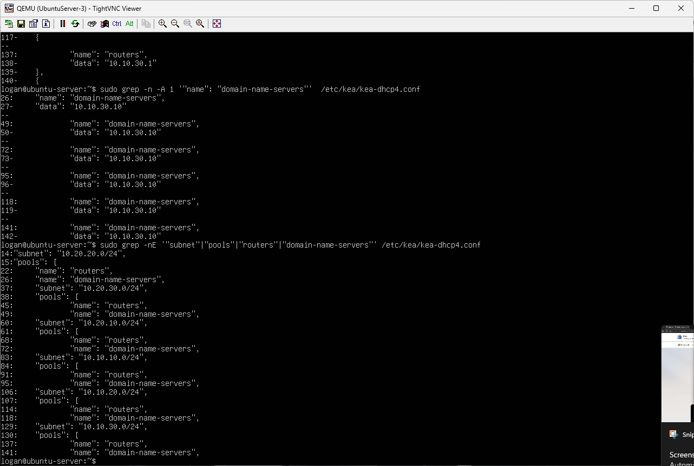
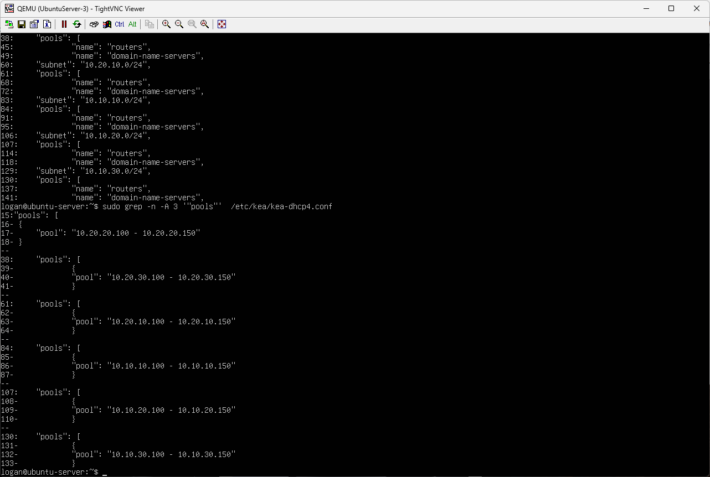
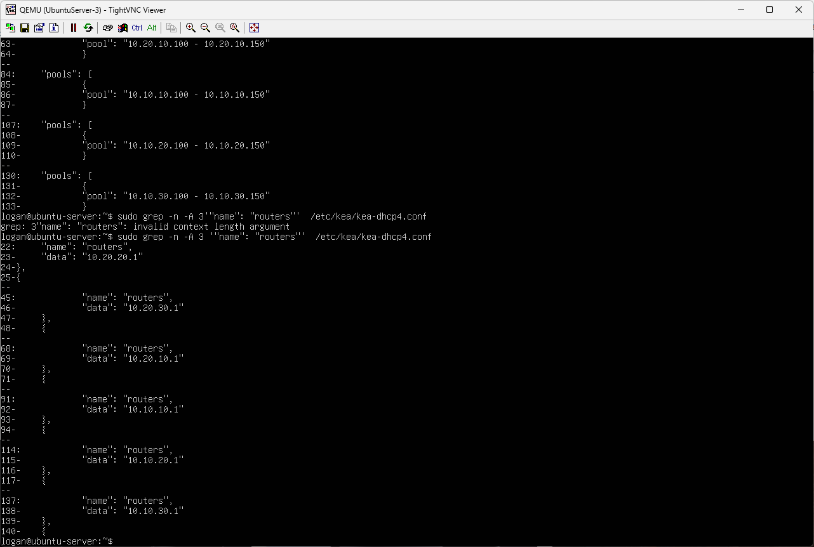
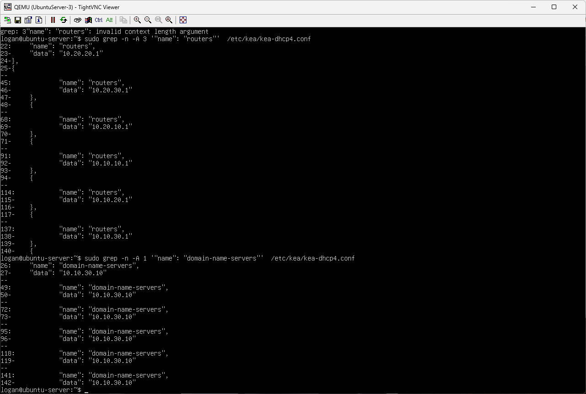

# IP Addressing and VLAN Plan

This document defines the VLAN and IPv4 addressing scheme used throughout the Mason-Troy Enterprise Network.

## Mason — Corporate Headquarters

| VLAN | Name | Subnet | Default Gateway | Purpose |

|---|---|---|---|---|

| 10 | Management | 10.10.10.0/24 | 10.10.10.1 | Network device management |

| 20 | Employees | 10.10.20.0/24 | 10.10.20.1 | Employee and business endpoints |

| 30 | Servers | 10.10.30.0/24 | 10.10.30.1 | Server infrastructure |

| 999 | Native | N/A | N/A | Dedicated unused native VLAN |

### Infrastructure Addresses

| Device | Interface / Role | IP Address |

|---|---|---|

| MASON-R1 | VLAN 10 Gateway | 10.10.10.1 |

| MASON-R1 | VLAN 20 Gateway | 10.10.20.1 |

| MASON-R1 | VLAN 30 Gateway | 10.10.30.1 |

| MASON-SW1 | Management SVI | 10.10.10.2 |

| Windows Server 2025 | Server | 10.10.30.10 |

| Ubuntu Server | Server | 10.10.30.20 |

## Troy — Manufacturing Facility

| VLAN | Name | Subnet | Default Gateway | Purpose |

|---|---|---|---|---|

| 10 | Management | 10.20.10.0/24 | 10.20.10.1 | Network device management |

| 20 | Employees | 10.20.20.0/24 | 10.20.20.1 | Employee and business endpoints |

| 30 | Legacy-OT | 10.20.30.0/24 | 10.20.30.1 | Isolated legacy manufacturing and OT systems |

| 999 | Native | N/A | N/A | Reserved native VLAN |

### Infrastructure Addresses

| Device | Interface / Role | IP Address |

|---|---|---|

| TROY-SW1 | VLAN 10 Gateway | 10.20.10.1 |

| TROY-SW1 | VLAN 20 Gateway | 10.20.20.1 |

| TROY-SW1 | VLAN 30 Gateway | 10.20.30.1 |

| Legacy Windows XP System | Manufacturing / OT Endpoint | 10.20.30.10 (Planned) |

## Mason–Troy WAN

The Mason and Troy sites are connected using a point-to-point routed link.

| Device | Interface / Role | IP Address |

|---|---|---|

| MASON-R1 | Troy WAN | 10.255.0.1/30 |

| TROY-SW1 | Mason WAN | 10.255.0.2/30 |

**WAN Network:** `10.255.0.0/30`

OSPF Area 0 is used across this link to dynamically exchange the Mason and Troy networks.

## Addressing Design

The addressing scheme was designed to make each site and network function easy to identify.

- Mason networks use the `10.10.x.0/24` address space.

- Troy networks use the `10.20.x.0/24` address space.

- Matching VLAN IDs are used at both sites where possible to maintain consistency.

- VLAN 10 is reserved for management traffic.

- VLAN 20 is used for normal employee and business traffic.

- VLAN 30 is assigned according to each site's infrastructure requirements: servers at Mason and legacy/OT manufacturing systems at Troy.

- VLAN 999 is reserved as the native VLAN and is not intended for endpoint traffic.

- The `10.255.0.0/30` network is dedicated to the point-to-point WAN connection between Mason and Troy.

## Centralized DHCP Addressing

DHCP services are centralized on the Ubuntu Server at `10.10.30.20`, running Kea DHCPv4.

Six DHCP subnet configurations support the Mason and Troy locations. DHCP relay is used to forward client requests from routed networks to the centralized server.

### Configured DHCP Scopes

| Site | VLAN | Subnet | DHCP Pool | Default Gateway | DNS Server |
|---|---|---|---|---|---|
| Mason | 10 | 10.10.10.0/24 | 10.10.10.100 - 10.10.10.150 | 10.10.10.1 | 10.10.30.10 |
| Mason | 20 | 10.10.20.0/24 | 10.10.20.100 - 10.10.20.150 | 10.10.20.1 | 10.10.30.10 |
| Mason | 30 | 10.10.30.0/24 | 10.10.30.100 - 10.10.30.150 | 10.10.30.1 | 10.10.30.10 |
| Troy | 10 | 10.20.10.0/24 | 10.20.10.100 - 10.20.10.150 | 10.20.10.1 | 10.10.30.10 |
| Troy | 20 | 10.20.20.0/24 | 10.20.20.100 - 10.20.20.150 | 10.20.20.1 | 10.10.30.10 |
| Troy | 30 | 10.20.30.0/24 | 10.20.30.100 - 10.20.30.150 | 10.20.30.1 | 10.10.30.10 |

### DHCP Validation

All six DHCP scopes were successfully validated through client-side testing using GNS3 VPC clients and Windows 11 endpoints.

| Site | VLAN | Validated DHCP Address | Status |
|---|---|---|---|
| Mason | 10 — Management | `10.10.10.102/24` | PASS |
| Mason | 20 — Employees | `10.10.20.102/24` | PASS |
| Mason | 30 — Servers | `10.10.30.100/24` | PASS |
| Troy | 10 — Management | `10.20.10.101/24` | PASS |
| Troy | 20 — Employees | `10.20.20.103/24` | PASS |
| Troy | 30 — Legacy/OT | `10.20.30.103/24` | PASS |

Additional DHCP validation was performed using the Mason and Troy Windows 11 workstations.

All six DHCP scopes distribute the centralized Active Directory DNS server address, `10.10.30.10`.

Photographic evidence of the six-VLAN DHCP tests is available in [Network Validation](validation.md), Section 18.

### DHCP Configuration Evidence

The following screenshots document the six configured Kea DHCP scopes, address pools, default gateways, and DNS server options.

**DHCP Subnets**

**DHCP Address Pools**

**DHCP Default Gateways**

**DHCP DNS Configuration**

