# Network Validation

This document records the tests used to verify connectivity, routing, server communication, and enterprise services throughout the Mason-Troy Enterprise Network.

Validation is performed throughout the build process rather than only after the network is complete. Additional security, DHCP, Internet, automation, and legacy/OT validation will be added as those phases are implemented.

## 1. Mason-Troy WAN Connectivity

### Objective

Verify Layer 3 connectivity across the point-to-point WAN between Mason and Troy.

### Network

- MASON-R1: `10.255.0.1/30`

- TROY-SW1: `10.255.0.2/30`

- WAN Network: `10.255.0.0/30`

### Result

Bidirectional connectivity across the WAN was successfully verified.

**Status: PASS**

---
## 2. OSPF Neighbor Adjacency

### Objective

Verify that MASON-R1 and TROY-SW1 successfully establish an OSPF neighbor relationship.

### Configuration

- OSPF Process: 1

- Area: 0

- MASON-R1 Router ID: `10.255.0.1`

- TROY-SW1 Router ID: `10.255.0.2`

### Result

A full OSPF adjacency was successfully established between MASON-R1 and TROY-SW1.

**Status: PASS**

---
## 3. OSPF Route Propagation

### OSPF Adjacency Evidence

MASON-R1 successfully established an OSPF FULL adjacency with TROY-SW1.

The `show ip ospf neighbor` output confirmed:

- Neighbor ID: `10.255.0.2`
- Neighbor address: `10.255.0.2`
- Neighbor state: `FULL/DR`
- Local interface: `GigabitEthernet0/1`

This validates OSPF neighbor establishment across the Mason–Troy routed WAN.

### Objective

Verify that both sites dynamically learn the remote site's networks.

### Mason Learning Troy

MASON-R1 successfully learned:

- `10.20.10.0/24`

- `10.20.20.0/24`

- `10.20.30.0/24`

Routes were learned through TROY-SW1 at `10.255.0.2`.

### Troy Learning Mason

TROY-SW1 successfully learned:

- `10.10.10.0/24`

- `10.10.20.0/24`

- `10.10.30.0/24`

Routes were learned through MASON-R1 at `10.255.0.1`.

### Result

Bidirectional OSPF route propagation was successfully verified.

**Status: PASS**

---
## 4. Mason Physical/Virtual Trunk

### Objective

Verify that the physical Mason network can carry VLAN traffic between GNS3 and MASON-SW1.

### Configuration

MASON-SW1 Fa0/5 is configured as an 802.1Q trunk carrying:

- VLAN 10

- VLAN 20

- VLAN 30

- VLAN 999

VLAN 999 is configured as the native VLAN.

The trunk connects:

`GNS3 Switch → GNS3 Cloud → USB-to-Ethernet Adapter → MASON-SW1 Fa0/5`

### Result

The trunk entered the forwarding state and successfully transported VLAN 30 traffic between virtual servers and the physical Cisco infrastructure.

**Status: PASS**

---
## 5. Windows Server Gateway Connectivity

### Objective

Verify that Windows Server 2025 can communicate through the physical/virtual network bridge with its default gateway.

### Configuration

- Windows Server: `10.10.30.10/24`

- Default Gateway: `10.10.30.1`

- VLAN: 30 — Servers

### Result

Windows Server successfully reached `10.10.30.1`.

This validated the path:

`Windows Server → GNS3 Switch → GNS3 Cloud → USB Ethernet → MASON-SW1 → MASON-R1`

**Status: PASS**

---
## 6. Ubuntu Server Gateway Connectivity

### Objective

Verify that Ubuntu Server can communicate with its default gateway through the same physical/virtual infrastructure.

### Configuration

- Ubuntu Server: `10.10.30.20/24`

- Default Gateway: `10.10.30.1`

- VLAN: 30 — Servers

### Result

Ubuntu Server successfully reached `10.10.30.1`.

**Status: PASS**

---
## 7. Server-to-Server Communication

### Objective

Verify bidirectional communication between the Windows and Ubuntu servers.

### Tests

Windows Server:

`10.10.30.10 → 10.10.30.20`

Ubuntu Server:

`10.10.30.20 → 10.10.30.10`

### Result

After configuring the appropriate Windows Firewall rule, bidirectional communication was successful.

**Status: PASS**

---
## 8. Active Directory Domain Services

### Objective

Verify successful deployment of the project's Active Directory environment.

### Configuration

- Domain: `masonmfg.internal`

- NetBIOS Name: `MASONMFG`

- Domain Controller: Windows Server 2025

- Domain Controller Address: `10.10.30.10`

- DNS Server: Enabled

- Global Catalog: Enabled

### Result

The server was successfully promoted as the first domain controller of the new forest.

Active Directory administrative tools became available after promotion and reboot.

**Status: PASS**

---
## 9. Active Directory DNS

### Objective

Verify that DNS contains the records required for Active Directory service discovery.

### Verified DNS Structure

The following Active Directory-integrated forward lookup zones were created:

- `_msdcs.masonmfg.internal`

- `masonmfg.internal`

Service records were verified for:

- Kerberos

- LDAP

- kpasswd

- Global Catalog

### Result

Active Directory DNS records were successfully created and verified.

**Status: PASS**

---
## 10. Reverse DNS

### Objective

Verify reverse DNS functionality for the Mason server network.

### Configuration

Reverse lookup zone:

`30.10.10.in-addr.arpa`

Network:

`10.10.30.0/24`

A PTR record was created for:

`10.10.30.10`

### Validation

Reverse lookup testing was performed using:

`nslookup 10.10.30.10`

The query successfully returned the domain controller's hostname and address.

### Result

Reverse DNS resolution is operational.

**Status: PASS**

---
## 11. Windows Security Auditing

### Objective

Verify that Windows Advanced Audit Policy settings are applied through Group Policy and generate Security log events during controlled Active Directory activity.

### Validation

Advanced Audit Policy settings were verified using `auditpol`.

Controlled tests produced the following Windows Security events:

- Event ID 4768 — Kerberos authentication ticket request
- Event ID 4769 — Kerberos service ticket request
- Event ID 4738 — User account modification
- Event ID 4728 — Member added to a security-enabled global group
- Event ID 4729 — Member removed from a security-enabled global group
- Event ID 5136 — Active Directory object modification

Directory Service Changes auditing was additionally validated using a SACL applied to descendant user objects.

Computer Account Management auditing was policy-validated but was not intentionally triggered for event-level validation.

### Result

Advanced Audit Policy configuration and multiple security auditing categories were successfully validated through effective policy and Windows Security event evidence.

**Status: PASS**

---

## 12. Kea DHCP and DHCP Relay

### Objective

Verify centralized DHCP address assignment from the Mason Ubuntu Server to a client on the remote Troy employee VLAN.

### Configuration

- Kea DHCP Server: `10.10.30.20`
- Troy Employee Network: `10.20.20.0/24`
- Troy Gateway: `10.20.20.1`
- DHCP Relay: `ip helper-address 10.10.30.20`
- DNS Server: `10.10.30.10`
- DNS Suffix: `masonmfg.internal`

### Validation

TROY-WIN11-01 successfully received:

- IPv4 address: `10.20.20.103/24`
- Default gateway: `10.20.20.1`
- DHCP server: `10.10.30.20`
- DNS server: `10.10.30.10`
- DNS suffix: `masonmfg.internal`

The client successfully reached both its local gateway and Mason infrastructure across the routed WAN.

### Result

Centralized Kea DHCP and Cisco DHCP relay successfully provided network configuration to the remote Troy employee VLAN.

**Status: PASS**

---

## 13. FortiGate and Internet Connectivity

### Objective

Verify that internal enterprise traffic can reach external networks through the FortiGate Internet edge.

### Validation

Internet connectivity was successfully demonstrated from both Mason infrastructure and the Troy Windows client.

TROY-WIN11-01 successfully pinged:

`8.8.8.8`

with 0% packet loss after the required default route was propagated through OSPF.

External DNS resolution was also successfully validated through the internal Windows DNS infrastructure.

### Result

The enterprise network successfully reaches external destinations through the Mason routing and FortiGate Internet path.

**Status: PASS**

---

## 14. OSPF Default Route Propagation

### Objective

Verify that Troy dynamically receives an Internet default route from Mason through OSPF.

### Configuration

MASON-R1 contains a static default route toward the FortiGate and advertises the default route through OSPF using:

`default-information originate`

### Validation

TROY-SW1 successfully learned:

`O*E2 0.0.0.0/0 [110/1] via 10.255.0.1`

The gateway of last resort on TROY-SW1 became `10.255.0.1`.

After convergence, TROY-WIN11-01 successfully reached `8.8.8.8`.

### Result

OSPF default-route propagation from Mason to Troy is operational.

**Status: PASS**

---

## 15. Troy Domain Join and Authentication

### Objective

Verify that a workstation located at the Troy site can join the Mason Active Directory domain and authenticate a domain user across the routed WAN.

### Validation

TROY-WIN11-01 successfully joined:

`masonmfg.internal`

After rebooting, the Troy employee test account successfully authenticated to the workstation.

`gpresult` identified the domain controller and confirmed domain-based policy processing.

### Result

Active Directory domain membership and domain authentication across the Mason-Troy WAN were successfully validated.

**Status: PASS**

---

## 16. Troy User Group Policy

### Objective

Verify that user-side Group Policy settings linked to the Troy Users OU apply to a Troy employee account.

### Validation

After signing in as the Troy employee test account:

- `gpupdate /force` completed successfully.
- `gpresult /r` listed Troy Workstation Policy under Applied Group Policy Objects.
- Membership in the expected Troy and shared-resource security groups was confirmed.
- Attempting to access the Windows Run command produced a policy restriction message.

The Troy Workstation Policy was also validated for its computer-side Settings Page Visibility restriction.

After identifying and enabling the previously disabled GPO link on the Troy Computers OU, network connectivity was restored and Group Policy processing was completed.

While signed in as `MASONMFG\test.employee`, the Windows Settings application no longer displayed the **System → About** page.

This confirmed successful behavioral enforcement of the configured `hide:about` restriction on `TROY-WIN11-01`.

**Status: PASS — Troy Run restriction and About-page visibility restriction validated.**

### Result

The Troy Workstation Policy is confirmed to apply to the Troy employee account, and the Run restriction has been behaviorally validated.

---

## 17. Domain Workstation Security Baseline

### Objective

Verify that the shared computer security baseline applies to TROY-WIN11-01 after correct Active Directory OU placement.

### Validation

After moving TROY-WIN11-01 into:

`OU=Computers,OU=Troy,OU=MasonMFG,DC=masonmfg,DC=internal`

computer-scope `gpresult` showed:

- Domain Workstation Security Baseline
- Default Domain Policy

The configured machine inactivity limit was independently checked using the Windows registry.

`InactivityTimeoutSecs` returned:

`REG_DWORD 0x12c`

which corresponds to 300 seconds.

### Result

The Domain Workstation Security Baseline successfully applies to the Troy workstation, and the configured five-minute inactivity timeout was validated.

**Status: PASS**

---

## 18. Six-VLAN Kea DHCP Validation

### Objective

Verify that the centralized Kea DHCPv4 server at `10.10.30.20` successfully distributes appropriate IPv4 network configurations to clients across all six Mason and Troy VLANs.

### Validation Results

DHCP testing was performed using GNS3 VPC clients connected to the appropriate VLANs.

| Site | VLAN | Network | Validated DHCP Address | Result |
|---|---|---|---|---|
| Mason | 10 — Management | 10.10.10.0/24 | 10.10.10.102 | PASS |
| Mason | 20 — Employees | 10.10.20.0/24 | 10.10.20.102 | PASS |
| Mason | 30 — Servers | 10.10.30.0/24 | 10.10.30.100 | PASS |
| Troy | 10 — Management | 10.20.10.0/24 | 10.20.10.101 | PASS |
| Troy | 20 — Employees | 10.20.20.0/24 | See endpoint evidence | PASS |
| Troy | 30 — Legacy/OT | 10.20.30.0/24 | 10.20.30.103 | PASS |

All six VLANs successfully received DHCP configuration from the centralized Kea service during their respective validation tests.

The Troy VLAN 20 Windows 11 workstation separately received `10.20.20.103/24`.

### Mason DHCP Evidence

**Mason VLAN 10 — Management**

**Mason VLAN 20 — Employees**

**Mason VLAN 30 — Servers**

### Troy DHCP Evidence

**Troy VLAN 10 — Management**

**Troy VLAN 10 — DHCP Configuration Details**

**Troy VLAN 20 — Employees**

**Troy VLAN 30 — Legacy/OT**

### Result

**Status: PASS — All Six VLANs**

Centralized DHCP address assignment was validated across the Mason and Troy VLANs.

These tests demonstrate successful client addressing within their respective VLANs. Additional connectivity tests shown in the evidence provide support for inter-VLAN routing, server reachability, and cross-site communication.

The configured DHCP scope definitions, pools, gateway options, and DNS options are documented separately in [IP Addressing and VLAN Plan](ip-vlan-plan.md).

---

## 19. Mason Windows 11 Domain Join and Group Policy Validation

### Objective

Verify that the Mason Windows 11 workstation successfully joins the centralized Active Directory domain, authenticates a domain user, resides in the correct organizational unit, and receives the shared workstation security baseline.

### Domain Join Validation

`MASON-WIN11-01` successfully joined the `masonmfg.internal` Active Directory domain.

Windows displayed the confirmation message:

"Welcome to the masonmfg.internal domain."

**Status: PASS**

### Domain Authentication and User Validation

The domain account `MASONMFG\test.manager` successfully authenticated on `MASON-WIN11-01`.

User-scope `gpresult /r` confirmed:

- The authenticated domain account and Mason Users OU placement.
- Group Policy processing through the Mason domain controller.
- Membership in `Mason-Employees`.
- Membership in `Shared-Resources-Group`.

No user-specific GPOs appeared in the applied policy results during this validation. Mason-specific user policy inspection and behavioral validation remain pending.

**Status: PASS — Domain authentication and security group membership**

### Computer Organizational Unit and Security Baseline

Computer-scope `gpresult /scope computer /r` confirmed that `MASON-WIN11-01` was located in:

`OU=Computers,OU=Mason,OU=MasonMFG,DC=masonmfg,DC=internal`

The following Group Policy Objects were successfully applied:

- Domain Workstation Security Baseline
- Default Domain Policy

This validates correct computer OU placement and application of the shared computer security baseline.

**Status: PASS — Computer OU placement and baseline GPO application**

### Result

**Status: PASS — Domain Join, Authentication, and Shared Computer Security Baseline**

The Mason workstation was successfully integrated into the centralized Active Directory environment.

Domain authentication, security group membership, computer OU placement, and shared computer security policy application were validated.

Mason-specific user Group Policy configuration and behavioral enforcement remain pending.

## 20. Cross-Site SMB File Sharing

### Objective

Verify that a domain-authenticated Troy employee can access and modify a shared resource hosted on the Mason Windows Server across the routed enterprise network.

### Validation

The Troy Windows 11 workstation, using the `MASONMFG\test.employee` account, successfully mapped `\\WIN-F40P5E8HDVL\CompanyShare` as drive `Z:`.

The employee modified and saved the `Company Information` text file through the mapped network drive.

The updated file was subsequently opened on the Mason Windows Server, confirming that the changes were successfully written across the network.

### Evidence

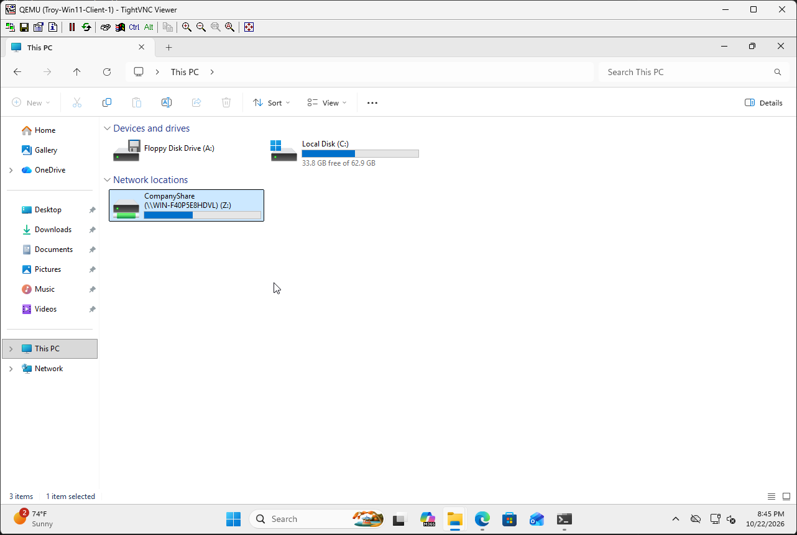

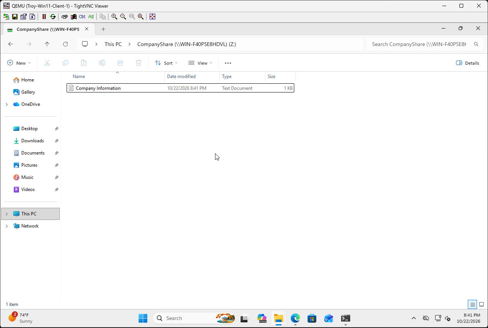

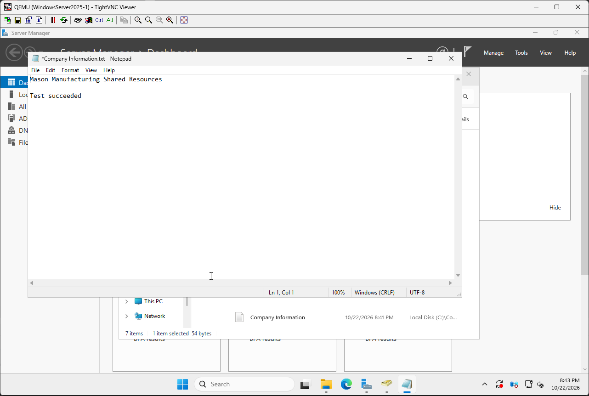

### Result

Cross-site SMB access and file modification were successfully validated using domain authentication.

**Status: PASS**

## 21. SMB Share and NTFS Permission Validation

### Objective

Verify that the CompanyShare resource uses Active Directory security group membership and Windows permissions to control access.

### Configuration

- Server: Windows Server 2025
- Shared folder: `C:\CompanyShare`
- Share name: `CompanyShare`
- Security group: `MASONMFG\Shared-Resources-Group`

Active Directory group membership was verified for:

- `test.manager` — Mason site
- `test.employee` — Troy site

### NTFS Permission Validation

The Shared-Resources-Group was confirmed to have:

- Modify
- Read & execute
- List folder contents
- Read
- Write

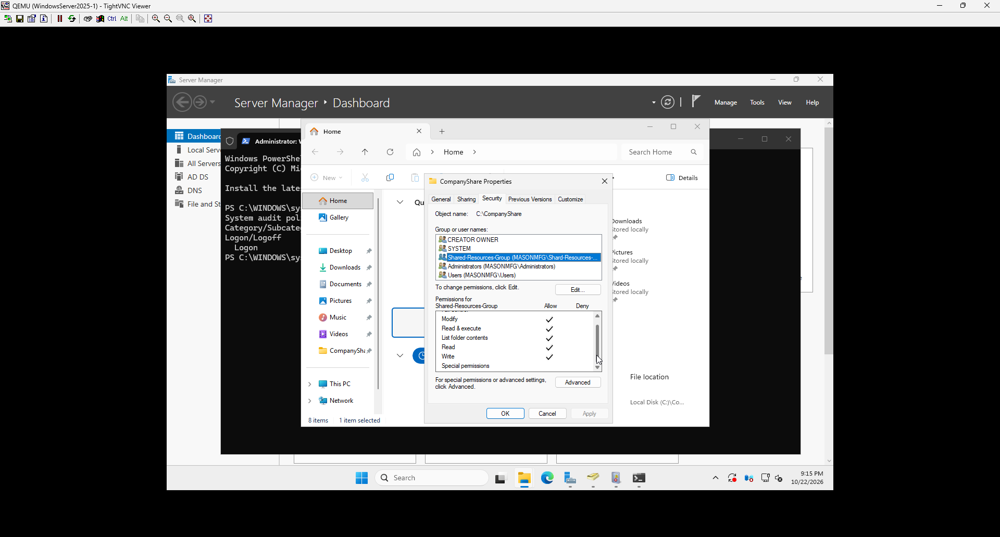

### SMB Share Permission Validation

The Shared-Resources-Group was confirmed to have:

- Change — Allow
- Read — Allow

Full Control was not granted at the share level.

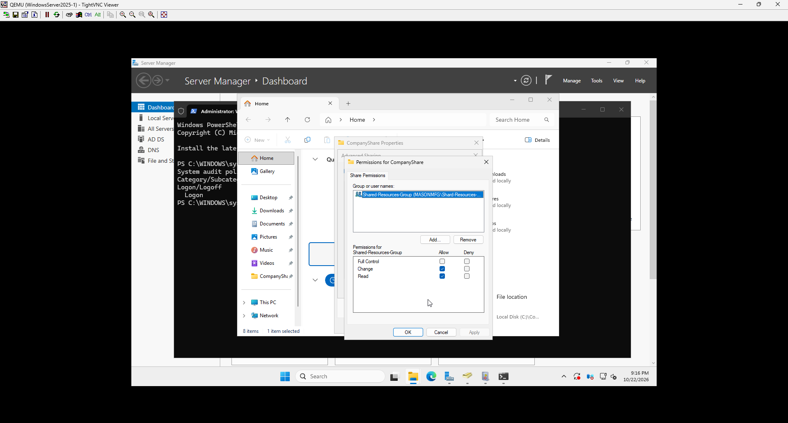

### Active Directory Group Membership

Both Mason and Troy test accounts were confirmed as members of the Shared-Resources-Group.

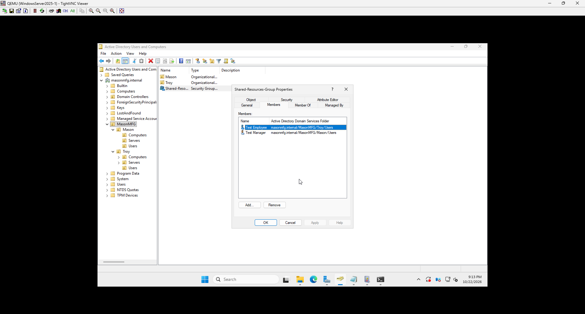

### Result

Group-based NTFS and SMB share permissions were verified.

Together with Section 20, the evidence demonstrates that an authorized Troy user successfully accessed and modified a file on the Mason Windows Server.

**Status: PASS**

## 22. Troy Network Authentication Auditing

### Objective

Verify that the Mason domain controller records successful network authentication from a domain user at the Troy site.

### Validation

Windows Server 2025 Security Event Viewer recorded:

- Event ID: 4624 — Successful Logon
- Account: `MASONMFG\test.employee`
- Logon Type: 3 — Network
- Source Network Address: `10.20.20.100`
- Source Workstation: Troy Windows 11 client
- Result: Audit Success

The event confirms that the Troy domain account successfully authenticated over the network.

This evidence is consistent with the successful SMB file-sharing validation documented in Section 20. However, Event 4624 alone does not identify the specific shared file accessed.

### Evidence

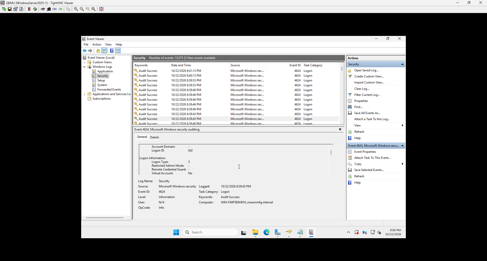

### Result

The domain controller successfully recorded a network logon for the Troy employee account originating from the Troy Windows 11 workstation.

**Status: PASS**

## 23. Windows Security Audit Policy and Kerberos Validation

### Objective

Verify that the Mason domain controller has successful and failed logon auditing enabled and records Kerberos authentication activity.

### Group Policy Configuration

The Windows Security Auditing Policy GPO was verified as linked to the Domain Controllers OU.

- Link Enabled: Yes
- GPO Status: Enabled
- Enforced: No

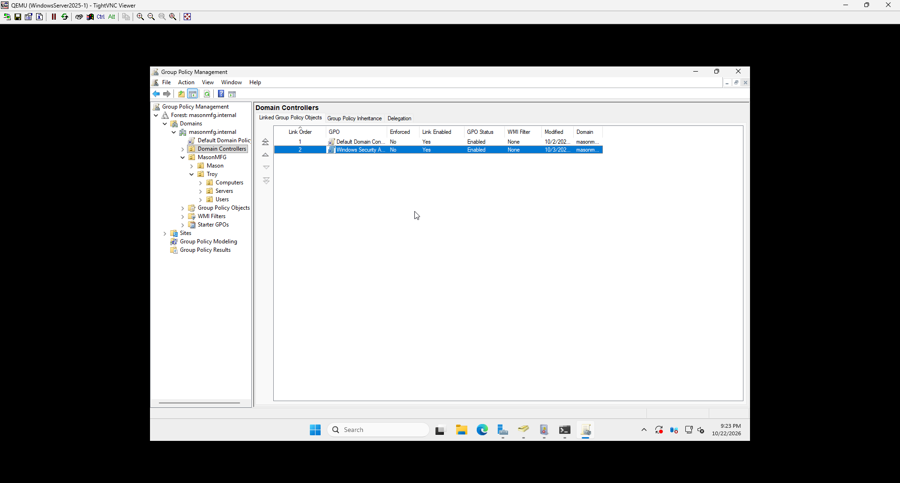

### Effective Audit Policy

The following command was executed on Windows Server 2025:

`auditpol /get /subcategory:"Logon"`

The effective policy returned:

`Logon    Success and Failure`

This confirms that both successful and failed logon auditing are enabled.

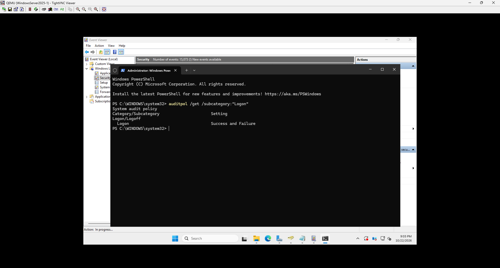

### Kerberos Authentication Auditing

Windows Security Event Viewer recorded:

- Event ID: 4769
- Event Category: Kerberos Service Ticket Operations
- Result: Audit Success

The event confirmed that a Kerberos service ticket request was recorded by the domain controller.

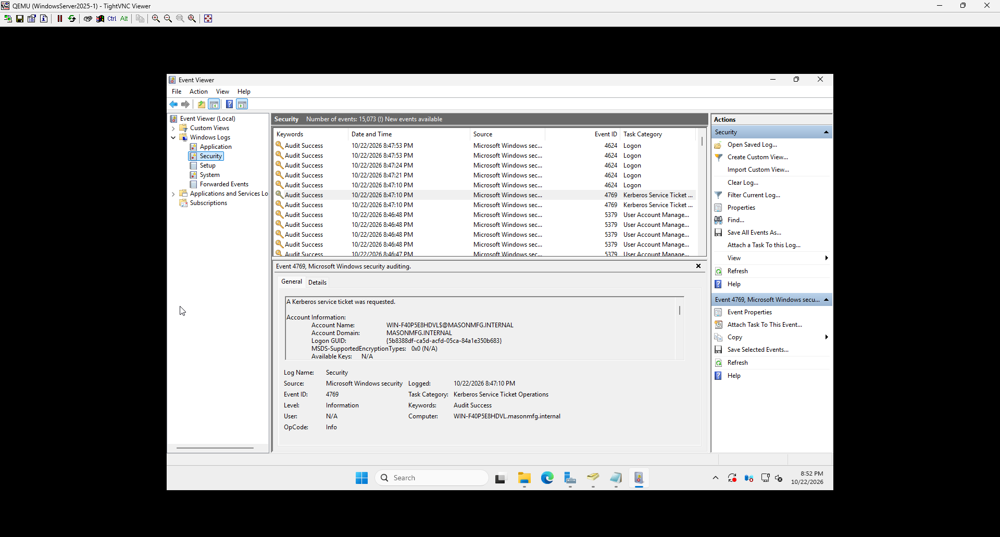

### Validation Limitations

Event ID 4624 was separately validated in Section 22.

Event ID 4625 was not observed during this validation. Therefore, failed-logon auditing was verified through effective policy configuration, but failed-logon event generation was not independently confirmed.

### Result

Windows Security Auditing Policy was confirmed as enabled and applied.

Successful network logon auditing and Kerberos service ticket auditing were validated through Event Viewer.

**Status: PASS — Audit configuration and successful event logging**

**Pending: Event 4625 failure-event validation**

## 24. Active Directory Organization and Group Policy Links

### Objective

Verify the organizational structure of the Mason-Troy Active Directory environment and the Group Policy links used to manage workstations at both sites.

### Active Directory Organization

The `masonmfg.internal` domain contains separate organizational units for the Mason and Troy sites.

Active Directory Users and Computers was used to verify the site OU hierarchy and the presence of the respective test user accounts.

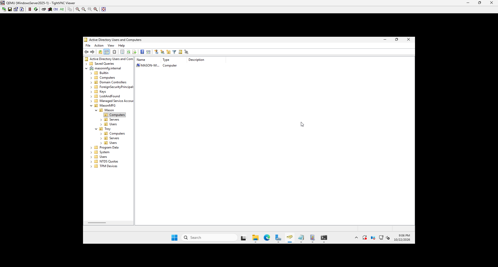

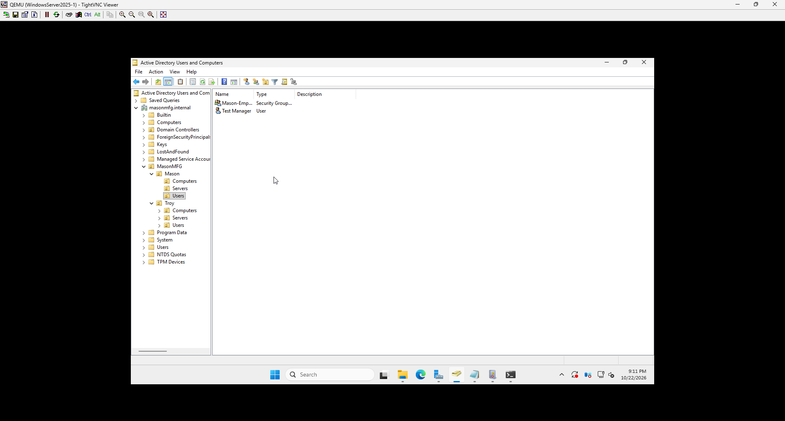

### Mason Workstation Group Policy

The Mason Computers OU has the following linked policy:

- Domain Workstation Security Baseline

The GPO link was verified as enabled, with GPO Status Enabled and Enforced set to No.

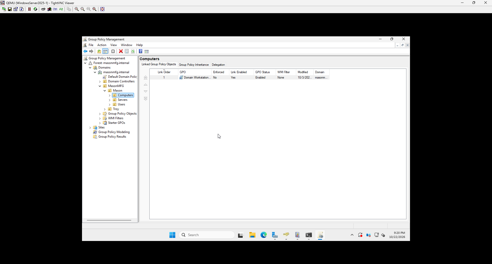

### Troy Workstation Group Policy

The Troy Computers OU contains two enabled policy links:

- Troy Workstation Policy
- Domain Workstation Security Baseline

Both links were verified as enabled, with GPO Status Enabled and Enforced set to No.

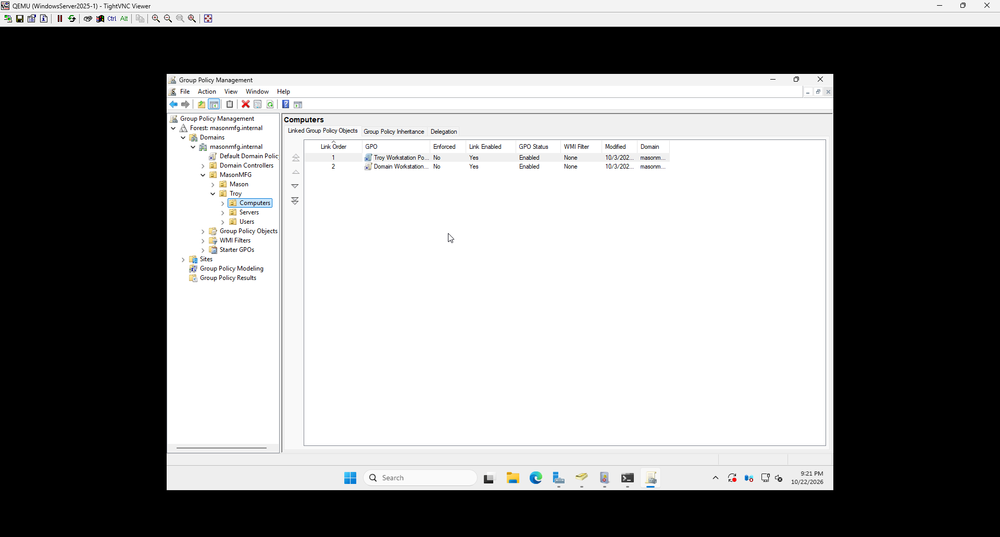

### Result

The domain's Mason and Troy organizational structure and workstation GPO links were verified through Active Directory Users and Computers and Group Policy Management.

Previous endpoint testing separately confirmed application of the shared workstation baseline and Troy-specific restrictions.

**Status: PASS**

## 25. DNS Configuration and External Resolution

### Objective

Verify that the Mason Windows Server provides internal Active Directory DNS records for both enterprise sites and successfully resolves external domain names.

### Internal DNS Configuration

The Windows Server 2025 domain controller hosts the `masonmfg.internal` forward lookup zone.

DNS Manager confirmed records for:

- `MASON-WIN11-01` — `10.10.20.101`
- `Troy-Win11-01` — `10.20.20.100`
- `ubuntu` — `10.10.30.20`
- `WIN-F40P5E8HDVL` — `10.10.30.10`

Active Directory DNS folders, including `_msdcs`, `_sites`, `_tcp`, and `_udp`, were also present.

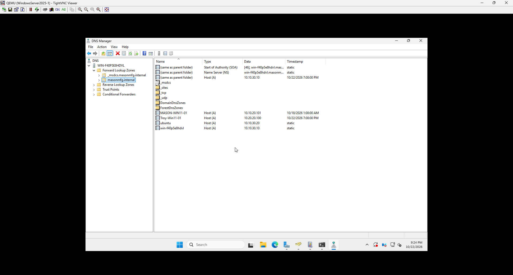

### DNS Forwarder Configuration

DNS Manager confirmed that `8.8.8.8` was configured as an external DNS forwarder.

Root hints fallback was also enabled.

Additional IPv6 placeholder entries were present but did not successfully resolve during inspection.

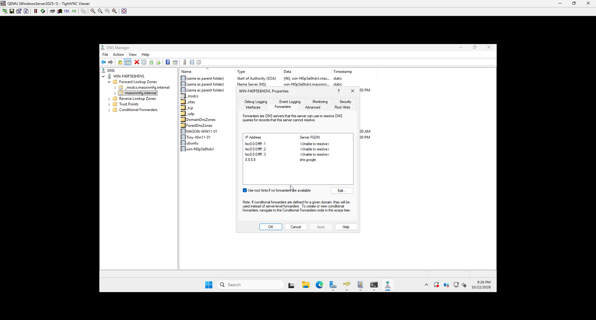

### External DNS Resolution Test

The following command was executed on the Mason Windows Server:

`nslookup google.com 10.10.30.10`

The internal DNS server returned a successful non-authoritative answer containing IPv4 and IPv6 addresses.

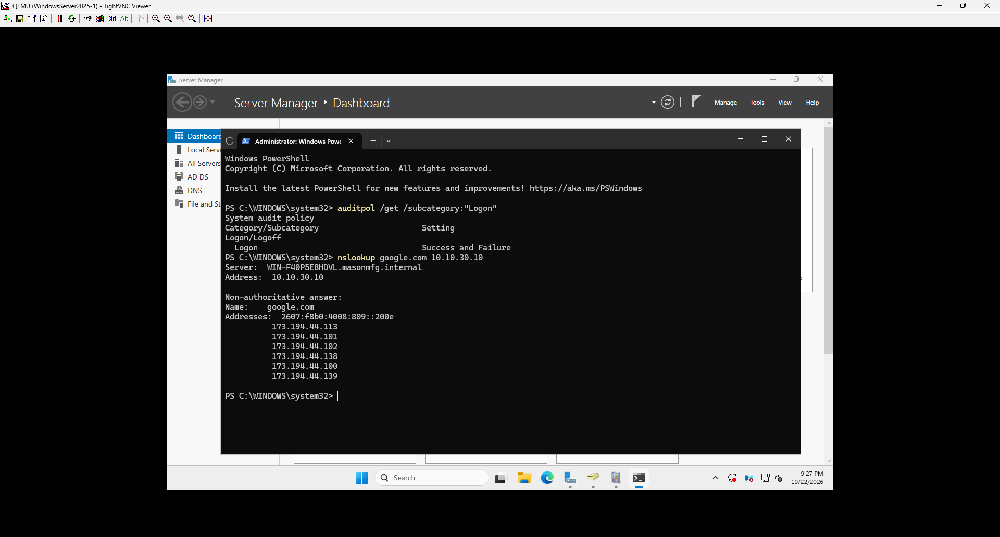

### Result

The Mason DNS server successfully maintained internal enterprise DNS records and resolved an external domain.

**Status: PASS**

## 26. Troy Legacy/OT VLAN 30 Isolation

### Objective

Verify that the Troy Legacy/OT network (`10.20.30.0/24`) is isolated from other routed enterprise networks using extended access control lists (ACLs), while preserving communication between devices within the local VLAN.

### Network Configuration

- Site: Troy
- VLAN: 30 — Legacy/OT
- Network: `10.20.30.0/24`
- Default gateway: `10.20.30.1`
- Layer 3 interface: `TROY-SW1 Vlan30`

Two extended ACLs were configured to enforce bidirectional routed isolation:

- `TROY-OT-IN` — Restricts traffic originating from the Legacy/OT VLAN.
- `TROY-OT-OUT` — Restricts routed traffic entering the Legacy/OT VLAN.

### Pre-ACL Validation

Before applying the isolation controls, connectivity tests demonstrated that the Legacy/OT test endpoint could reach its default gateway and Mason infrastructure across the routed WAN.

These tests established a baseline for comparison after ACL enforcement.

### Post-ACL Validation

After applying the ACLs, additional connectivity tests confirmed that routed communication between the Legacy/OT network and other enterprise networks was restricted.

Validation included:

- Testing outbound communication from the Legacy/OT VLAN.
- Testing inbound communication toward the Legacy/OT VLAN.
- Inspecting ACL deny counters.
- Confirming that denied traffic incremented the appropriate ACL counters.

Communication between devices within the same Legacy/OT VLAN remained possible because local Layer 2 switching does not require routing through the VLAN interface.

### Evidence

**ACL configuration:**

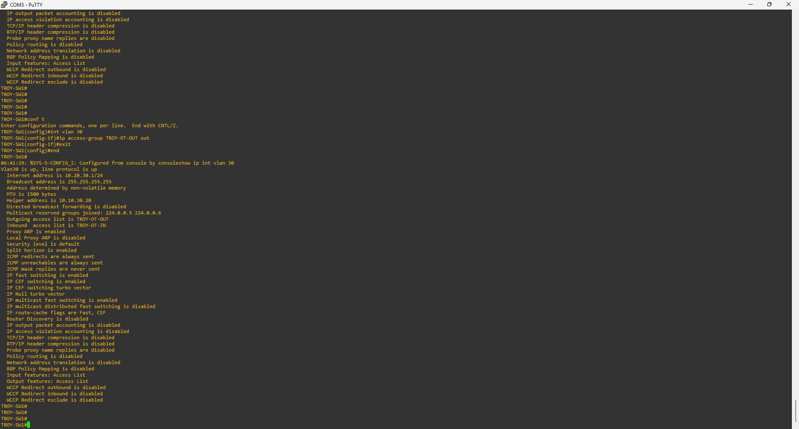

**Pre-ACL connectivity:**

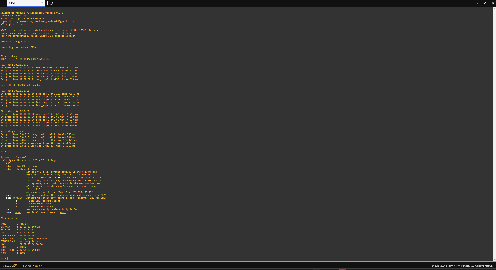

**Post-ACL connectivity:**

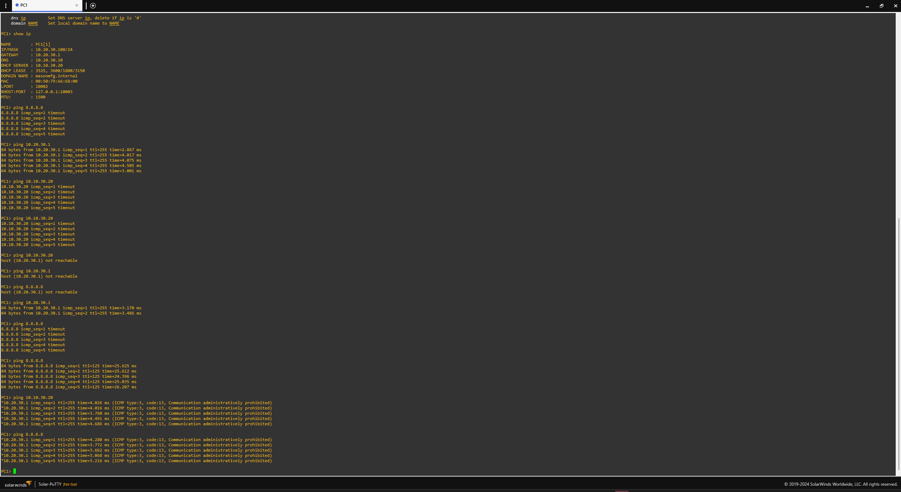

**Inbound isolation validation:**

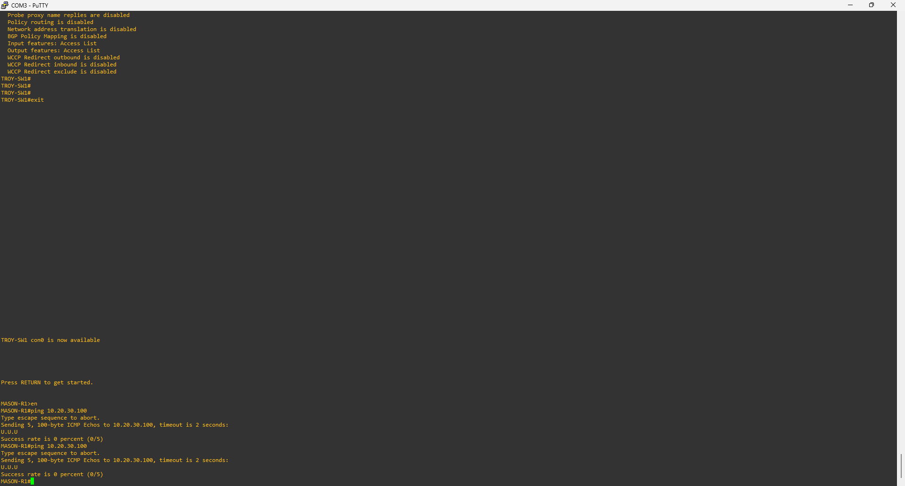

**ACL enforcement and deny counters:**

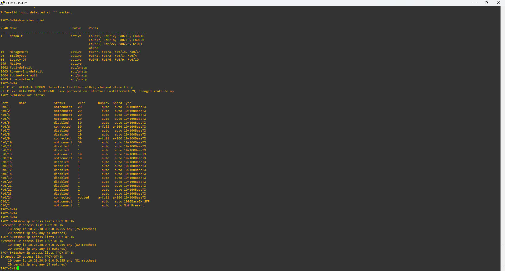

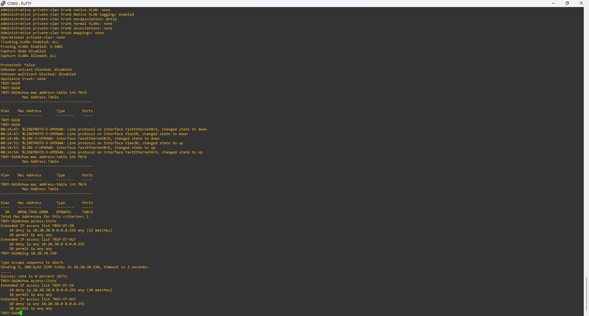

### Validation Limitations

DHCP functionality was validated on Troy VLAN 30 before the isolation ACLs were applied. DHCP operation after ACL enforcement has not been independently verified.

The ACLs enforce routed network isolation; they do not prevent direct Layer 2 communication between devices within the same VLAN.

### Result

**Status: PASS — Bidirectional routed Legacy/OT isolation validated.**

Extended ACLs successfully restricted routed communication into and out of Troy VLAN 30. Connectivity testing and incrementing deny counters provided evidence of enforcement.

## 27. FortiGate Firewall Policy Validation

### Objective

Verify that the FortiGate firewall enforces configured traffic policies, permits authorized outbound services, blocks unauthorized traffic, and records network activity.

### Configuration

The FortiGate firewall provides security controls at the enterprise Internet edge.

Firewall policies were configured to distinguish workstation and server traffic.

The configuration includes:

- Workstation Internet access policies.
- Server Internet access policies.
- Service-based traffic restrictions.
- Network Address Translation (NAT).
- Firewall traffic logging.
- Implicit deny behavior for traffic without a matching allow policy.

### Validation

Controlled connectivity tests were performed to evaluate firewall policy behavior.

The collected evidence demonstrates:

- Successful HTTPS requests through an authorized firewall policy.
- Successful NTP traffic through the firewall.
- Allowed and denied traffic during workstation testing.
- Allowed and denied traffic during server testing.
- Firewall policy traffic counters increasing during network activity.
- Firewall traffic logs recording permitted connections.

The before-and-after traffic screenshots demonstrate increasing policy activity. They do not independently establish that a firewall configuration change occurred.

### Evidence

**Firewall policy configuration:**

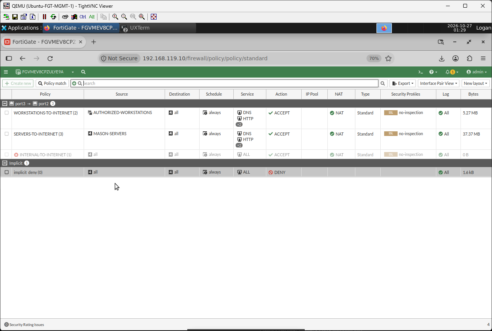

**Workstation allow/deny validation:**

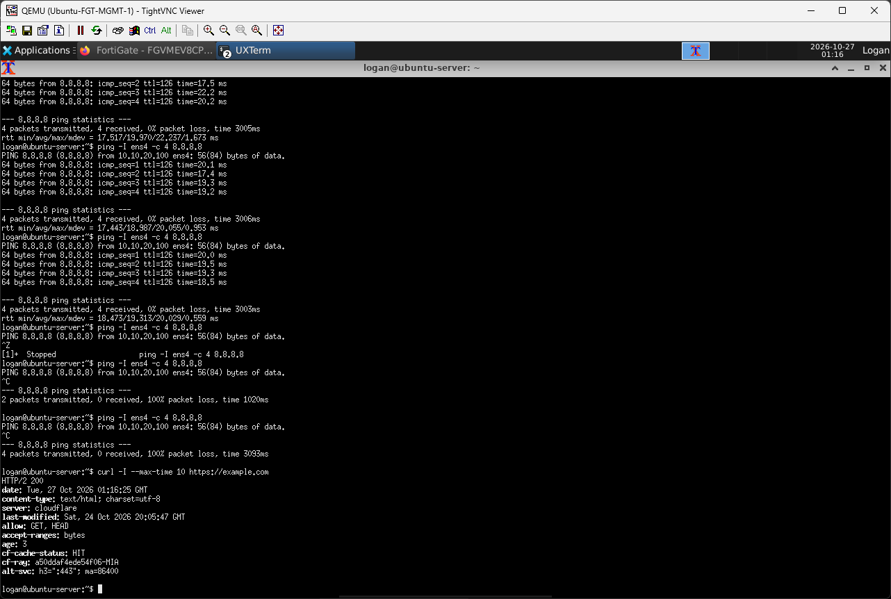

**Server allow/deny validation:**

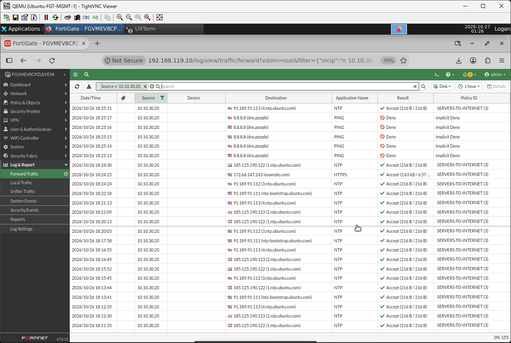

**HTTPS traffic validation:**

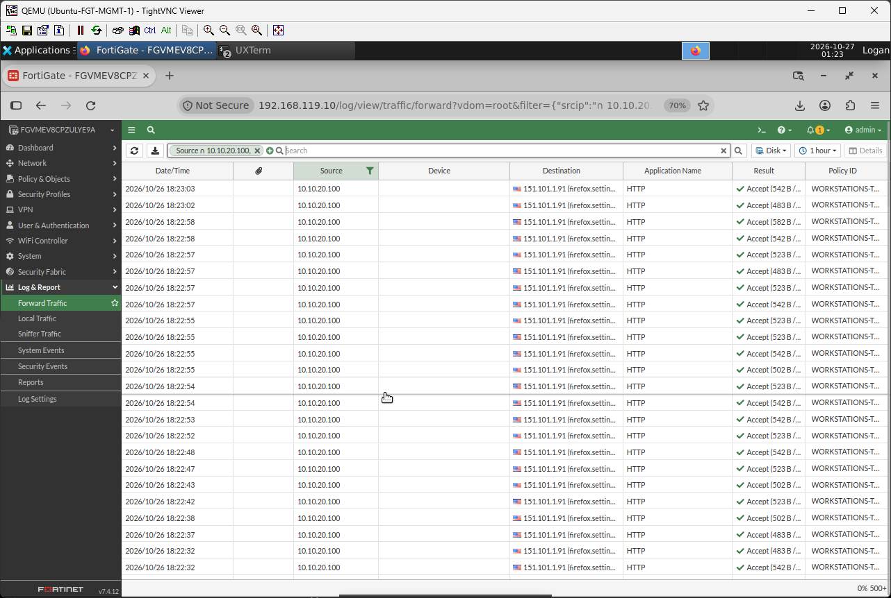

**NTP traffic validation:**

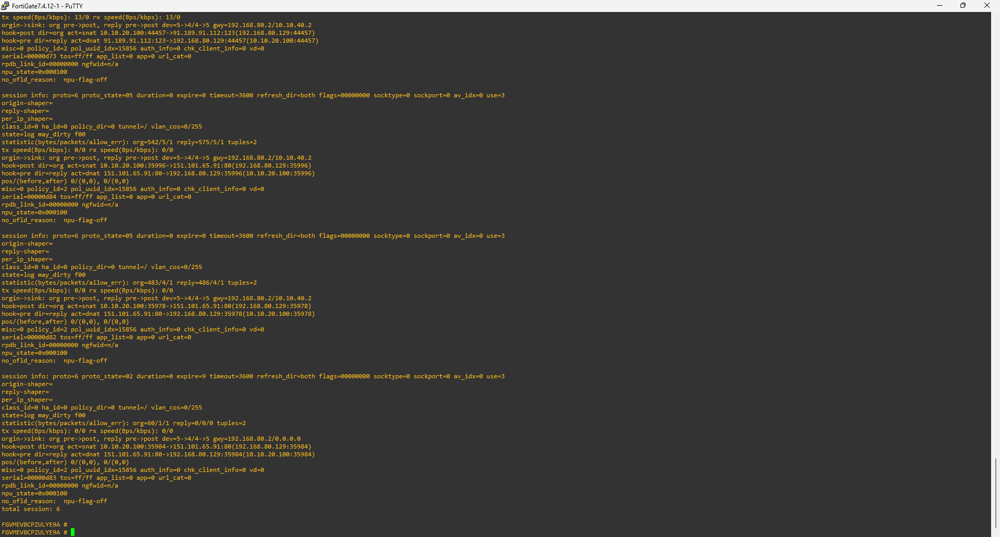

**Firewall logging:**

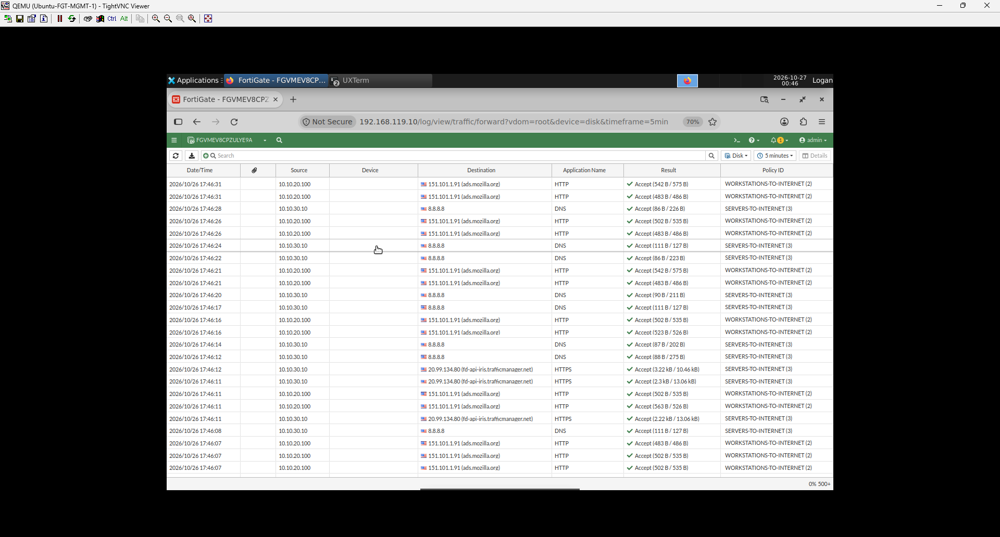

**Before-and-after policy traffic counters:**

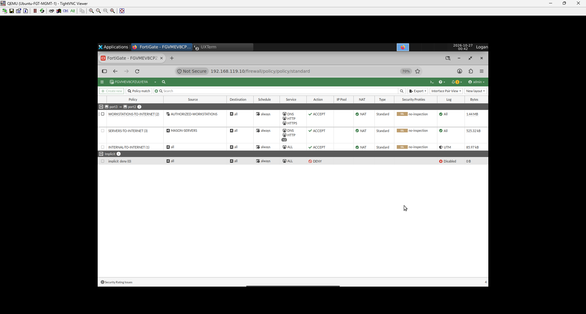

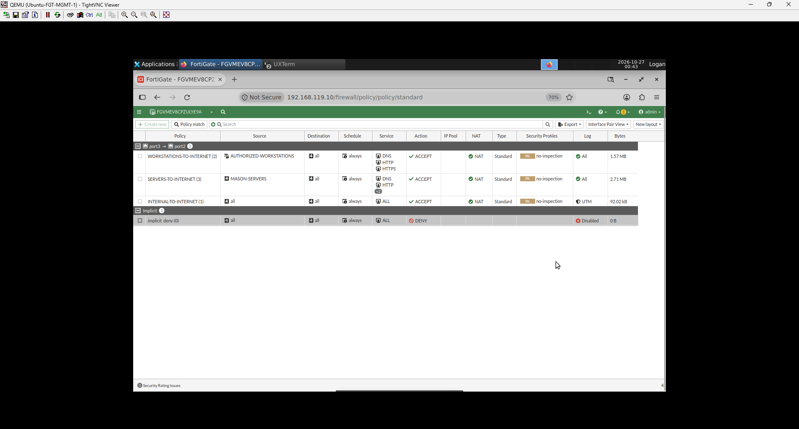

### Validation Limitations

Traffic counters confirm that packets matched firewall policies but do not independently demonstrate that unauthorized traffic was blocked.

The allow/deny tests provide separate behavioral evidence of policy enforcement.

The Mason-to-FortiGate transit network (10.10.40.0/30) subsequently experienced an unresolved ARP connectivity failure. Earlier successful firewall policy and Internet connectivity tests remain valid historical evidence, but current end-to-end Internet connectivity requires revalidation. The separate FortiGate VMnet1 management connectivity issue also remains unresolved.

### Result

**Status: PASS — FortiGate firewall policy enforcement and traffic logging validated.**

The FortiGate successfully processed authorized traffic, enforced service-based restrictions during controlled testing, and recorded network activity.

## 28. Troy Switch Security Hardening

### Objective

Verify the implementation of Layer 2 security controls and secure management services on the Troy Cisco Catalyst switch.

### Port Security Configuration

Port security was configured on 12 access ports of TROY-SW1.

The verified configuration included:

- Maximum of one learned MAC address per protected port.
- Port-security violation mode set to `restrict`.
- Port security enabled on the selected access interfaces.
- Configuration saved to startup configuration.

The verification output showed zero recorded port-security violations at the time of inspection.

**Evidence:**

### PortFast and BPDU Guard

PortFast and BPDU Guard were configured on selected access interfaces.

These controls support faster endpoint connectivity while helping protect access ports against unexpected spanning-tree participation.

Configuration inspection confirmed that the relevant settings were present.

**Evidence:**

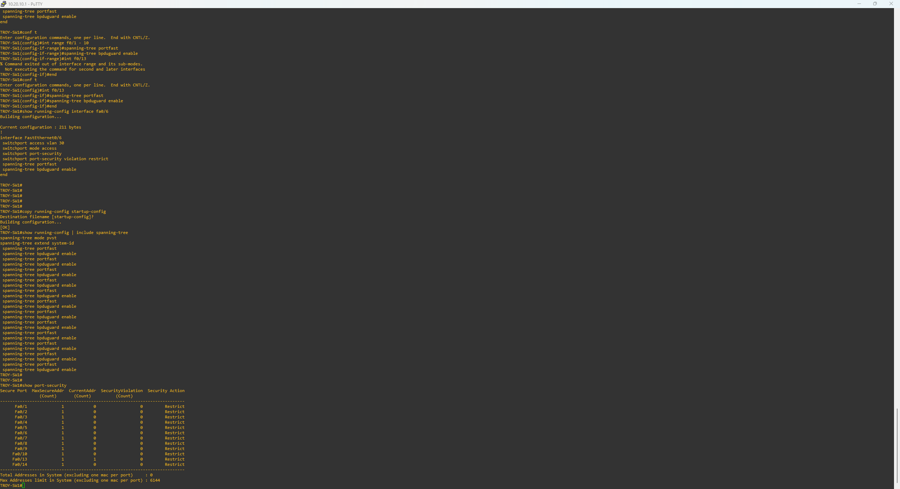

### Secure Management

SSH version 2 was verified as enabled on TROY-SW1.

Management testing demonstrated:

- An SSH login prompt.
- A configured login warning banner.
- Successful authenticated access to the switch.
- An active remote management session.
- HTTP management disabled.
- HTTPS management disabled.

**Evidence:**

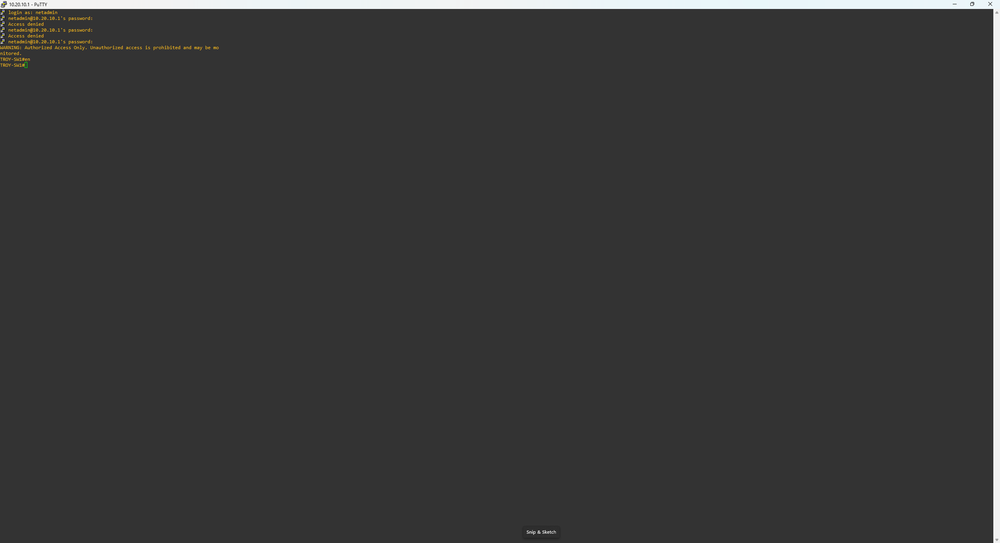

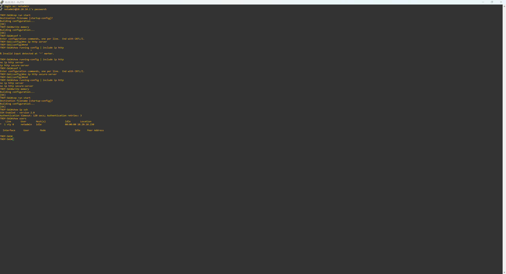

### Validation Limitations

The collected evidence confirms the presence of port-security, PortFast, and BPDU Guard configuration.

However:

- An unauthorized MAC address was not introduced to test port-security violation behavior.
- BPDU Guard shutdown behavior was not tested using an unexpected BPDU.
- Telnet was not independently verified as disabled.

These controls are therefore configuration-validated rather than fully behaviorally tested.

### Result

**Status: PASS — Switch security configuration verified.**

Port security, PortFast, BPDU Guard, SSHv2, and disabled HTTP/HTTPS management were verified on TROY-SW1.

Additional behavioral testing would be required to establish full enforcement of every configured security control.

---

## Validation Still Required

The following tasks remain outstanding or require additional testing:

- Investigate the earlier File Explorer restriction when accessing `CompanyShare` through direct UNC navigation. Cross-site SMB authentication and file modification have already been validated.
- Verify DHCP operation on Troy VLAN 30 after applying the Legacy/OT isolation ACLs.
- Perform unauthorized MAC address testing to validate port-security violation behavior.
- Perform BPDU Guard enforcement testing, if a safe test environment is available.
- Independently verify that Telnet management access is disabled on TROY-SW1.
- Validate authorized management access across the intended network boundaries.
- Implement centralized logging and monitoring beyond the existing Windows Security and FortiGate logs.
- Develop and validate Python/Netmiko automation.
- Validate automated configuration backup functionality.
- Perform Wireshark protocol analysis.
- Complete final end-to-end enterprise connectivity testing.
- Complete final end-to-end security testing.

### Completed Security Milestones

The following security features have been implemented and documented:

- **Legacy/OT isolation:** Bidirectional routed ACL enforcement validated through connectivity testing and deny counters.
- **FortiGate firewall:** Authorized traffic, denied traffic, and firewall logging validated.
- **Switch hardening:** Port security, PortFast, BPDU Guard, SSHv2, and disabled HTTP/HTTPS management verified through configuration inspection.
- **Windows security auditing:** Advanced Audit Policy and multiple Security event categories validated.
- **Workstation Group Policy:** Troy workstation restrictions and shared security baseline validated.

## Validation Approach

Each major project phase follows the same general process:

**Build → Verify Configuration → Test Connectivity or Service → Troubleshoot if Necessary → Retest → Document Results**

A feature is not considered complete solely because its configuration exists. Expected behavior must also be demonstrated through testing.
